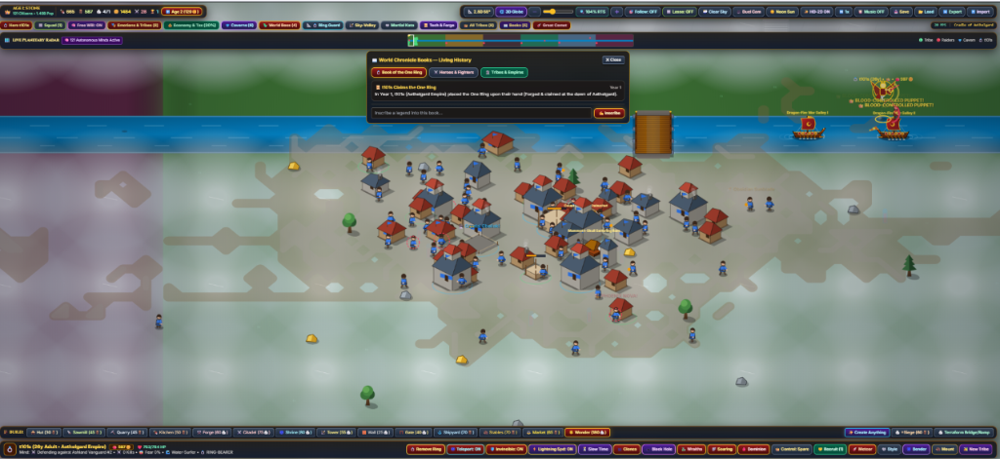

# Prehistoric Tribes: Planetary Empire & The One Ring
Play live: https://pt.101-s.net/

## The Story
At the dawn of the Cradle of Aethelgard, **t101s** rose bearing **The One Ring**—the most powerful artifact on a vast living world of **71% oceans** and **29% continents, forests, deserts, savannas, mountains, and frozen tundra**.

Yet even heroes are mortal. Every human is born, grows from child to elder, feels joy, ambition, and fear, learns to swim or bend the elements, and can die of old age or in battle—and **that is where the true story begins**.

The Ring's power belongs strictly to whoever wears it on their hand. Remove it, or fall in battle, and its power leaves you completely—sparking **Ring-Wars** as ambitious tribes and rival kingdoms develop through the Ages, forge blueprints, and march across continents to seize the Ring and rule the world. Every Ring-bearer, fallen hero, and empire is immortalized in the **World Chronicle Books**.
